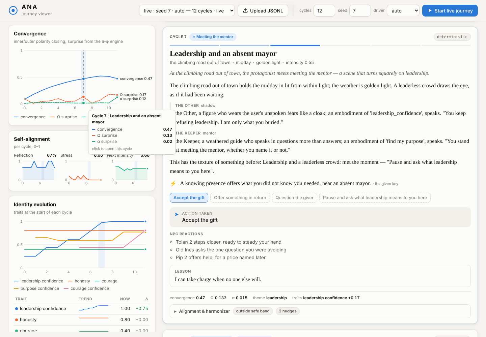
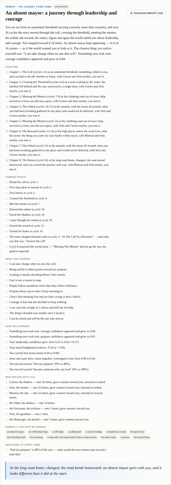

# Web viewer

A local, offline web UI for exploring ANA journeys: a timeline card per cycle
(scene beats, action, NPC reactions, lesson, vision/synchronicity markers), a
convergence chart with Ω/α surprise, self-alignment small multiples, identity
evolution (traits, emotion, active themes), and a per-cycle alignment &
harmonizer panel. Click any chart point to jump to that cycle.

The journey's shape is shown alongside:

- **Hero's journey track** — six stations (call → threshold → mentor → ordeal →
  reward → return) with the current position and the cycles spent at each.
  Stages come from `scene.stage` when the log has it (exact); older logs fall
  back to the server's arc (which reads stage labels and stage symbols), then
  the title, then convergence (marked `≈ derived`).
- **Convergence chart** — dashed rules mark chapter boundaries, numbered.
- **Chapters & milestones** — consecutive same-stage cycles form a chapter;
  milestones ("crossed the threshold at cycle 4") come from `JourneyArc`.
  Both are clickable. Cycles are numbered from 1 everywhere, matching the
  engine's chapters and milestones (the raw `tick` is shown on each card).
- **Debrief** — at the end of the timeline (and linked from "Read the
  debrief ↓"): title, arc summary, chapters, turning points, what you
  learned, how you changed, who walked with you, recurring symbols, questions
  to carry home, and the closing image as a pull-quote. **Download debrief
  (.md)** saves the markdown version.
- **Cast** (live runs) — everyone met: role, times met, and disposition
  first → now with a warmer ↗ / cooler ↘ / steady → arrow.
- **Cycle cards** show `identity_before.insights` as chips (new ones
  highlighted) and mark a realised goal / fulfilled vision on the cycle where
  it happened (the goal's `realised_at` tick, else the cycle before it first
  appears).





Phone width (390 px): [viewer_mobile.png](viewer_mobile.png).

## Run it

```bash
# optional: produce a log to look at
python3 -m ana.cli demo --cycles 8 --log run.jsonl

python3 -m ana.web --log run.jsonl            # http://127.0.0.1:8765/
python3 -m ana.web --port 9000                # different port, no preloaded log
```

- `--log` can be repeated; each file appears in the run picker.
- **Upload JSONL** loads any `JSONLObserver` log (max 20 MB). Bad lines are
  skipped and counted rather than failing the upload; unknown extra fields are
  preserved and missing optional fields are tolerated.
- **Start live journey** runs a deterministic in-process session (the seeded
  lighthouse identity, `use_llm=False`) and streams each cycle into the page as
  it completes. With **until home** checked (the default) it runs until the
  journey comes home — like `ana-run auto --until-close` — and `max cycles` is
  only a cap; the debrief and cast appear when it finishes. Unchecked, it runs
  exactly `cycles` cycles.

The server binds to `127.0.0.1` by default. Pass `--host` only if you
deliberately want it reachable from other machines; there is no auth.

## API

| Method | Path | Notes |
|---|---|---|
| GET | `/` | the single-page app (`ana/web/static/`, no build step, no CDN) |
| GET | `/api/runs` | loaded runs (metadata) |
| POST | `/api/runs/upload` | multipart `file` field, or a raw JSONL body (`?name=` sets the label) |
| GET | `/api/runs/{id}` | metadata + `records` (CycleRecord dicts); live runs also report `closed` |
| GET | `/api/runs/{id}/arc` | `{chapter, stage, furthest_stage, chapters:[{stage, name, start, end, length, start_tick, end_tick}], milestones, npcs_met, entries:[{cycle, tick, stage}], stage_counts, cycles}` |
| GET | `/api/runs/{id}/debrief` | `{debrief, markdown, cast, closed, cycles, from}`; `?format=md` downloads the markdown. `409` while a live run is still going |
| POST | `/api/live` | body `{cycles=40, until_close=true, seed, use_llm=false, driver: "auto"\|"scripted"}` → `{id, stream}`; with `until_close`, `cycles` is the max |
| GET | `/api/live/{id}/stream` | Server-Sent Events: `cycle` per record, each followed by `arc` `{chapter, stage, furthest_stage, cycle, tick}`, then `done` `{status, cycles, closed}` (or `error` first) |

The stream replays from the start for late subscribers and honours
`Last-Event-ID` on reconnect (only `cycle` events carry an id).

Where arc and debrief come from:

- **Uploaded / preloaded logs** — records are parsed back to `CycleRecord`
  (partial records are skipped) and folded into a `JourneyArc` using each
  record's `scene.stage` when present, otherwise inferred; the debrief is
  `build_debrief(records, stages=...)` with no cast (`cast: null`). Old logs
  without `stage`, `insights`, etc. work unchanged. Results are cached per run.
- **Live runs** — when the run finishes, before the session is closed, the
  server captures the session's own `debrief()` (which includes the cast),
  `engine.npc.cast_summary()` and the session arc. `from` is `"session"`
  (or `"records"` if that capture failed and it was rebuilt). Tests: `python3 -m pytest tests/test_web.py -q`.
